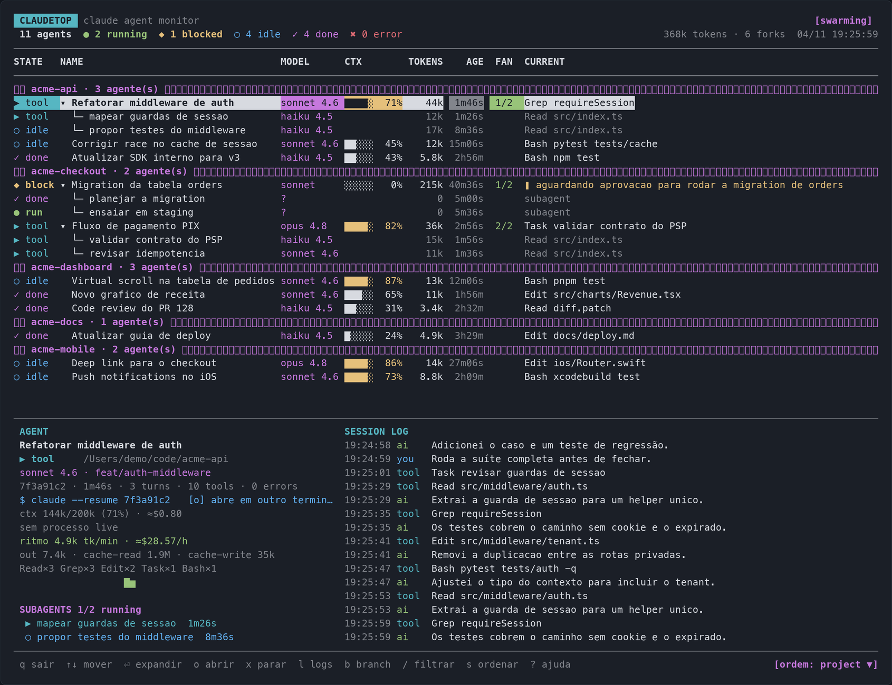

# claudetop

Monitor estilo `htop` para **agentes do Claude Code** — sessões, jobs em background e swarms de subagentes — em tempo real, direto no terminal.

Lê apenas estado local (`~/.claude`), não faz rede, não precisa de GUI nem de dependências (Python 3 + `curses`; no Windows, `windows-curses`, instalado automaticamente pelo pipx).



<sub>Captura com dados fictícios (projetos e agentes de exemplo).</sub>

```
 CLAUDETOP  claude agent monitor                                            [swarming] [advising]
 6 agents  ● 3 running  ◆ 1 blocked  ○ 2 idle  ✓ 4 done   1.2M tokens · 18 forks   04/11 17:38:37
──────────────────────────────────────────────────────────────────────────────────────────────
STATE  NAME                            MODEL      CTX        TOKENS    AGE  FAN  CURRENT
◆ block  Migration do checkout          sonnet 5.5 ██░░░  45%   1.3k  20m00s  1/2  preciso de aprovacao para rodar a migration
✓ done     └─ mapear o repo             haiku 4.5                403  1m00s       mapeou 4 módulos
▶ tool     └─ auditar call sites        haiku 4.5                403    20s       Grep call sites
```

## Instalação

### Homebrew

```bash
brew tap braynemesis/claudetop
brew trust braynemesis/claudetop   # Homebrew 7+: confia no tap
brew install claudetop
```

Depois disso: `brew upgrade claudetop` e `brew uninstall claudetop`. A fórmula instala o CLI isolado no prefixo do Homebrew, depende de `python@3.14` e mostra os atalhos ao final da instalação.

Se preferir um comando único (sem `tap`/`trust`): `brew install braynemesis/claudetop/claudetop`.

### Linux e Windows (pipx)

```bash
pipx install git+https://github.com/braynemesis/claudetop
```

No Windows o `windows-curses` vem como dependência. Terminais suportados para `o`: `x-terminal-emulator`, `gnome-terminal`, `konsole`, `kitty`, `wezterm`, `xterm` (Linux) e Windows Terminal / `cmd` (Windows); use `CLAUDETOP_OPEN` para outro. Suporte a Linux/Windows é novo: relate problemas.

### Manual

```bash
mkdir -p ~/.local/bin
chmod +x claudetop.py
ln -sf "$PWD/claudetop.py" ~/.local/bin/claudetop
claudetop
```

`~/.local/bin` já está no seu `PATH`. Para rodar sem instalar: `python3 claudetop.py`.

## Uso

```bash
claudetop                     # TUI ao vivo (refresh 1s)
claudetop --all               # inclui sessões antigas e as internas (/var/folders)
claudetop --hours 24          # janela de sessões por mtime (default: 8h)
claudetop --interval 0.5      # refresh mais rápido
claudetop --filter sySP-336   # já abre filtrado
claudetop --sort state        # já abre por prioridade (default: project)
claudetop --once              # snapshot em texto (sem TUI)
claudetop --json              # snapshot machine-readable (pipe/jq)
```

### Atalhos

| tecla | ação |
|---|---|
| `↑` `↓` / `j` `k` | mover seleção |
| `⏎` / `espaço` | expandir/recolher subagentes |
| `tab` | alternar foco tabela ⇄ log |
| `/` | filtrar (nome, cwd, modelo, tarefa, subagente) |
| `1` `2` `3` `4` `5` | filtrar: precisa de mim · rodando · idle · done · stale |
| `0` | limpar o filtro de estado |
| `p` | pausar/retomar o refresh |
| `s` | ordenar: state → age → tokens → name → project |
| `f` | fixar/desafixar no topo (persistido) |
| `d` / `D` | ocultar agente / restaurar todos os ocultos |
| `a` | mostrar tudo (inclui stale e sessões temporárias) |
| `r` | forçar releitura completa dos arquivos |
| `o` | abrir: job → `claude attach` · sessão → `claude --resume` |
| `O` | copiar o comando em vez de abrir |
| `l` | abrir os logs do job em outro terminal (`claude logs`) |
| `x` / `X` | parar o job (`claude stop`) / apagar job + histórico (`claude rm`) — 2 toques |
| `b` / `B` | abrir a branch do agente no browser / formulário de PR |
| `y` | copiar o caminho do transcript (pbcopy) |
| `?` | ajuda |
| `q` | sair |

## Abrir a sessão em outro terminal

`o` abre o agente selecionado numa janela nova de terminal, já no `cwd` dele. Jobs em background usam o caminho oficial `claude attach <id>` (retoma com o output ao vivo); sessões interativas usam `claude --resume <session-id>`. O comando aparece no painel de detalhe. `O` apenas copia o comando para o clipboard. Em subagentes, abre a sessão-pai, que é a que tem transcript retomável.

O terminal é escolhido pelo `TERM_PROGRAM`: `iTerm.app` → iTerm2, `Apple_Terminal` → Terminal.app. Dentro de tmux, ssh ou terminal de IDE o `TERM_PROGRAM` não identifica o app, então o default é o Terminal.app. Para forçar outro:

```bash
CLAUDETOP_OPEN=iterm claudetop                      # iTerm2
CLAUDETOP_OPEN=terminal claudetop                   # Terminal.app
CLAUDETOP_OPEN='wezterm start -- sh -c {qcmd}' claudetop
CLAUDETOP_OPEN='alacritty -e sh -c {qcmd}' claudetop
```

No template, `{cmd}` é a linha de comando pronta para um shell e `{qcmd}` é a mesma linha já citada (aspas) para terminais que recebem o comando como argumento único. Se a abertura falhar, o comando é copiado para o clipboard e o erro aparece no rodapé.

## Ações em jobs em background

O Claude Code expõe um CLI para os jobs (`claude agents --json`), e o claudetop usa isso como fonte de estado ao vivo — com cache de 15s para não spawnar processo a cada refresh.

| tecla | comando | efeito |
|---|---|---|
| `x` | `claude stop <id>` | para o job, mantendo a conversa retomável com `o` |
| `X` | `claude rm <id>` | apaga o job e o histórico (**irreversível**) |
| `l` | `claude logs <id>` | abre o output completo em outro terminal |
| `o` | `claude attach <id>` | abre o job no terminal, ao vivo |

`x` e `X` pedem confirmação: o mesmo toque duas vezes em até 4s. Só valem para jobs em background; em subagente, a ação aponta para o job pai.

Se o `state.json` do job disser `working` mas o processo não estiver vivo, o agente aparece como **`⚠ orphan`** — estado que o arquivo não tem. O detalhe mostra o pid e o status reportados pelo CLI quando o job está vivo.

### Desligar a integração

```bash
CLAUDETOP_NO_CLI=1 claudetop          # não chama o CLI oficial
CLAUDETOP_CLAUDE_BIN=/caminho/claude claudetop
```

A integração também é desligada automaticamente quando `CLAUDETOP_CLAUDE_DIR` está setado (usado nos testes com `~/.claude` falso).

## Organização

- **`f` fixa** o agente no topo da lista, em qualquer modo de ordenação. **`d` oculta** um agente (útil para `done` antigos); **`D`** restaura todos. Pins e ocultos ficam em `~/.cache/claudetop/state.json` — nunca em `~/.claude`.
- **Filtro por estado**: `1` = precisa de mim (`blocked` + `orphan` + `error`), `2` = rodando (`working` + `tool`), `3` = idle, `4` = done, `5` = stale, `0` = todos. O filtro ativo aparece no rodapé.
- **Agrupamento por projeto**: o modo `project` da tecla `s` insere cabeçalhos `── projeto · N agente(s) ──` e ordena por `cwd`. A navegação pula cabeçalhos automaticamente.

## Métricas

- **Ritmo (tokens/min) e custo/hora** no painel de detalhe, calculados pelo delta de tokens/custo entre duas leituras do refresh. Mostra quem está queimando contexto *agora*, não só o acumulado.
- **Histórico local** em `~/.cache/claudetop/history.jsonl`: uma amostra a cada ~60s por agente (`t`, `k`, `s`, `tk`, `c`, `sub`), com rotação em 5MB. O detalhe usa esse histórico para mostrar há quanto tempo o agente está no estado atual (ex.: `neste estado há 12m`).
- **`b` / `B`** montam a URL da branch / do formulário de PR a partir de `git remote get-url origin` + branch do agente (sem API) e abrem no browser. Suporta Bitbucket, GitHub e GitLab, inclusive remotes SSH. `CLAUDETOP_OPEN_DRY=1` só mostra a URL no rodapé.

## Ordenação

A tecla `s` cicla entre cinco modos. A ordenação ativa aparece em dois lugares: **seta na coluna correspondente** do cabeçalho (`STATE▼`, `TOKENS▼`, `NAME▲`) e **badge no rodapé** (`[ordem: tokens ▼]`), que continua visível mesmo em terminal estreito. Ao trocar, uma mensagem curta confirma o critério.

| modo | critério | seta |
|---|---|---|
| `state` | prioridade de atenção: `blocked` → `error` → `orphan` → `working` → `tool` → `idle` → `done` → `stale`; empate por atividade mais recente | ▼ |
| `age` | atividade mais recente primeiro (`updated` decrescente) | ▼ |
| `tokens` | mais tokens primeiro (`input + output + cache_creation`) | ▼ |
| `name` | alfabética, case-insensitive | ▲ |
| `project` (default) | agrupado por projeto (`cwd`), com cabeçalho e contagem por grupo | ▼ |

Só os agentes-pai (sessões e jobs) são reordenados; subagentes ficam aninhados sob o pai. A ordenação é estável: empates preservam a ordem anterior. Use `--sort <modo>` para escolher o modo inicial em `--once`, `--json` e na TUI.

## De onde vem cada número

| Campo | Fonte |
|---|---|
| nome, `state`, tarefa atual | `~/.claude/jobs/*/state.json` (jobs em background) e `ai-title`/`agent-name`/`last-prompt` do transcript |
| `state` ao vivo / pid | `claude agents --json` (cache 15s) — tem prioridade sobre o arquivo para `blocked`/`done`/`error` |
| `MODEL` | `message.model` do último turno assistente (mais preciso que `--model` do job) |
| `CTX` | última `usage`: `input + cache_read + cache_creation` ÷ janela do modelo (200k, ou 1M se o modelo indicar) |
| `TOKENS` | `input + output + cache_creation` acumulados — **cache read fica de fora** (senão o contador infla ~100×) |
| `FAN` | subagentes rodando / total (`subagents/agent-*.jsonl` + array `fan` do job) |
| `AGE` | início → agora (para subagentes: duração) |
| log | `jobs/*/timeline.jsonl` para jobs; cauda do transcript para sessões |
| custo (detalhe) | preços de tabela hardcoded em `PRICES` — **estimativa**, não é fatura |
| ritmo, histórico | delta entre refreshes; amostras em `~/.cache/claudetop/history.jsonl` |

### Estados

`● run` ativo · `▶ tool` tool em execução · `◆ block` esperando input · `⚠ orphan` job marcado como rodando sem processo vivo · `○ idle` parado há <15min · `✓ done` · `✖ error` · `· stale` sem atividade há muito tempo.

Heurística de sessão: pendente em `tool_use` → `tool`; atividade <90s → `run`; <15min → `idle`; `end_turn` antigo → `done`.

## Design

A interface segue a referência visual do vídeo sobre *Claude Code subagent swarms*: lead + subagentes em árvore (`└─`), barra de contexto por agente, contadores globais, tags `[swarming]`/`[advising]`, painel `session log` com timestamps e rodapé de comandos. O comando `claude --resume <sessão>` do agente selecionado aparece no painel de detalhe.

## Testes

```bash
python3 tests/smoke_test.py
```

Monta um `~/.claude` falso (job bloqueado + 2 subagentes + transcript) e valida snapshot, JSON, estados, junção job↔subagente, comandos de abertura e as URLs de branch/PR. O CLI oficial é desligado nos testes (`CLAUDETOP_CLAUDE_DIR`).

## Limitações

- Formato de `~/.claude` é interno do Claude Code: `jobs/`, `timeline.jsonl` e `subagents/` podem mudar entre versões. O parser ignora linhas desconhecidas em vez de quebrar.
- Somente leitura em `~/.claude`. A única escrita é o estado próprio em `~/.cache/claudetop/` (`state.json` de pins/ocultos e `history.jsonl`).
- `state.json` de job envelhece; `claude agents --json` corrige `blocked`/`done`/`error`/órfão, mas depende do CLI oficial estar no `PATH`. Sem ele, vale a heurística local. Se o job não tiver transcript, `CTX`/`TOKENS` ficam zerados.
- Custo usa preços fixos de Opus/Sonnet/Haiku — ajuste `PRICES` se necessário.
- Testado em macOS (Python 3.13, curses). Funciona em Linux; `y` (pbcopy) é macOS-only.

## Licença

MIT — veja [LICENSE](LICENSE).
